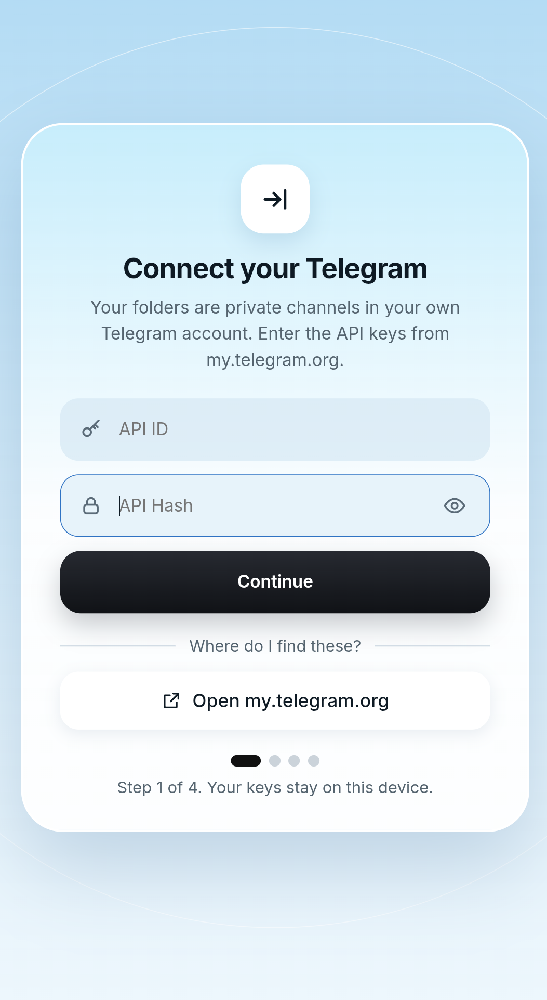
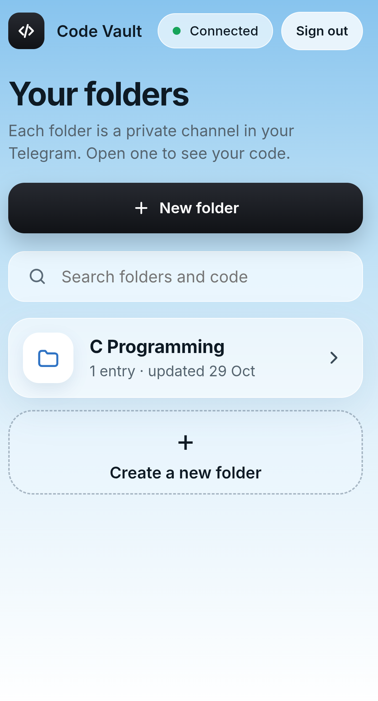
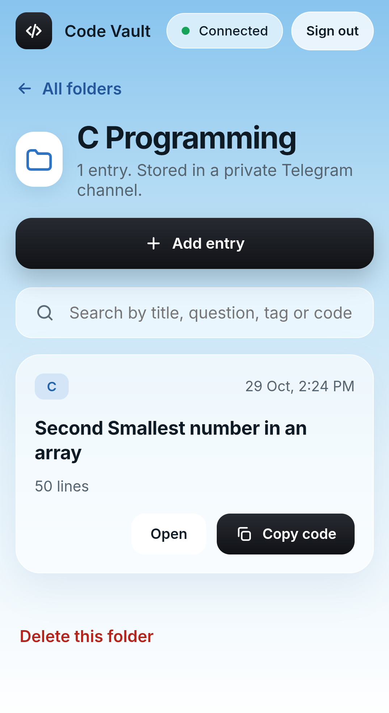
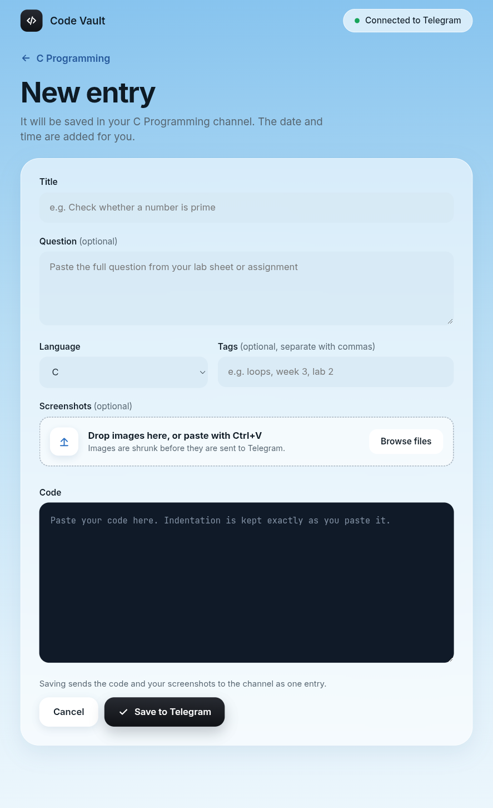
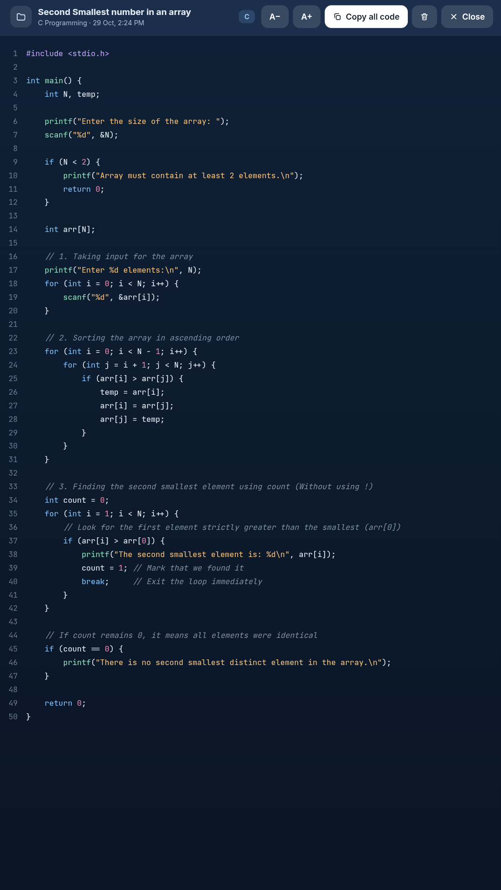
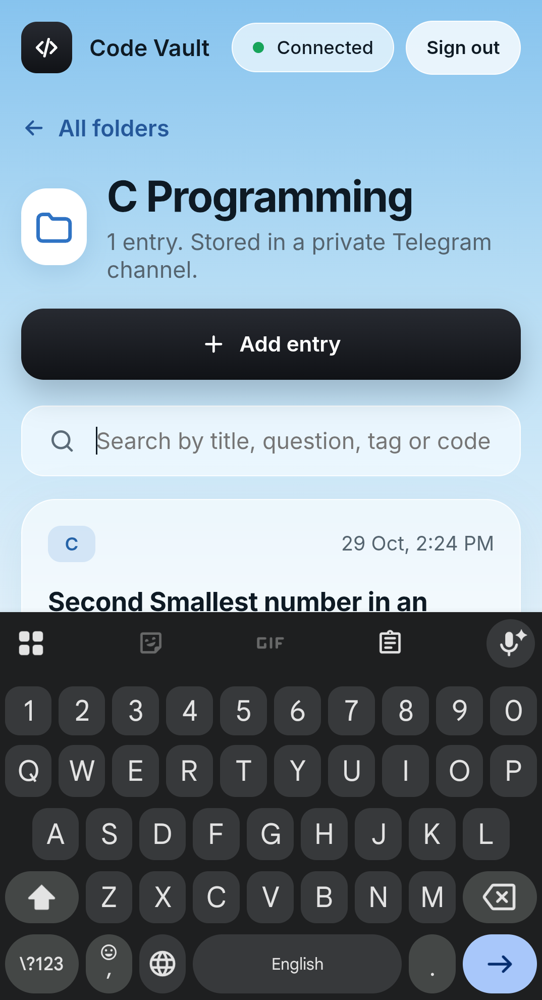

# Code Vault (TeleCloud) 💻🔐

<p align="center">
  
</p>

<p align="center">
  
  
  
  
  
  
</p>

**Code Vault** is a lightweight web app that turns your own Telegram account into a free, private vault for your coursework code. Create folders, save code files with the question and screenshots, and find everything again later from any browser on Android or Windows. Nothing is stored on a third-party server.

🔗 **Live app:** [telecloud-six.vercel.app](https://telecloud-six.vercel.app)

---

## 📌 Table of Contents
- [✨ Key Features](#-key-features)
- [📷 Screenshots](#-screenshots)
- [🧭 How It Works](#-how-it-works)
- [📁 Storage & Data](#-storage--data)
- [🚀 Getting Started & User Guide](#-getting-started--user-guide)
  - [Prerequisites](#prerequisites)
  - [How to Obtain Telegram API Credentials](#how-to-obtain-telegram-api-credentials)
  - [Logging In](#logging-in)
  - [Creating Folders and Entries](#creating-folders-and-entries)
  - [Install as an App](#install-as-an-app)
- [🛠️ Developer Guide](#️-developer-guide)
  - [Project Directory Structure](#project-directory-structure)
  - [Run Locally](#run-locally)
  - [Deploy to Vercel](#deploy-to-vercel)
- [⚙️ Troubleshooting](#️-troubleshooting)
- [⚠️ Disclaimer](#️-disclaimer)

---

## ✨ Key Features

*   **☁️ Free Storage in Your Own Telegram**: Every folder is a private Telegram channel in your account. Your code lives in Telegram, so there is no extra server, database or bill.
*   **📂 Folders per Subject**: Create one folder for each course, such as "C Programming" or "Data Structures". Open a folder to see all of its entries, newest first.
*   **📝 Rich Entries**: Save the code file together with a title, language, tags, the original question text and screenshots. The date and time are added automatically.
*   **🔍 Search Everything**: Search folder names, and also entry titles, questions, tags and the code itself, across all your folders.
*   **🎨 Code Viewer**: Full-screen viewer with line numbers and syntax colours for C, C++, Java, Python, JavaScript, SQL and HTML/CSS.
*   **📱 Works on Android and Desktop**: Responsive layout for phones, tablets and computers, with a bottom-sheet style dialog on small screens.
*   **📲 Installable (PWA)**: Add it to your home screen or desktop from the browser menu and open it like a normal app.
*   **🔒 Private by Design**: Your API keys and login session stay in your own browser. The app talks directly to Telegram.

---

## 📷 Screenshots

> Add your own screenshots to a `screenshots/` folder (PNG), or delete this section.

<p align="center">
  
  
  
  
  
  
</p>

<p align="center"><sub>Login · Folders · Entries · New Entry · Code Viewer · Search</sub></p>

---:|:---:|:---:|
| <br/>**Login** | <br/>**Folders** | <br/>**Entries** |
| <br/>**New Entry** | <br/>**Code Viewer** | <br/>**Search** |

---

## 🧭 How It Works

| Concept | What it is in Telegram |
| :--- | :--- |
| **Folder** | A private channel whose title starts with `CV · ` |
| **Entry (code)** | A document message holding the code file, with a `#cv` caption that stores the title, language, tags and time |
| **Entry (question)** | An optional text message tagged `#cvq` with the question |
| **Entry (screenshots)** | An optional photo or album tagged `#cvi` |

When you open the site, Code Vault reads your channels that start with `CV · ` and rebuilds your folders and entries from the messages inside them.

---

## 📁 Storage & Data

*   **Your code and screenshots**: Stored as messages in your private `CV · ` channels on Telegram.
*   **API ID and API Hash**: Saved in this browser's `localStorage` only.
*   **Login session**: Saved in this browser's `localStorage` only.
*   **Screenshots**: Shrunk to at most 1600 px and sent as JPEG before upload.
*   **Questions**: Text longer than about 3,900 characters is cut.

> [!WARNING]
> Anyone with access to your browser profile can use your Telegram session. Only sign in on devices you own.

---

## 🚀 Getting Started & User Guide

### Prerequisites
*   An active Telegram account.
*   A modern browser on Android or Windows (Chrome, Edge or Firefox).

### How to Obtain Telegram API Credentials
Code Vault needs your own API credentials to connect to Telegram. This is free and takes about 2 minutes:
1. Go to [my.telegram.org](https://my.telegram.org/) and log in with your phone number.
2. Select **API development tools**.
3. Fill in the form (an app title and short name of your choice).
4. Copy the **App api_id** and **App api_hash**.
5. Paste them into the first screen of Code Vault.

> [!NOTE]
> These credentials stay in your browser. The app does not send them to any server other than Telegram.

### Logging In
1. Open the site and enter your **API ID** and **API Hash**.
2. Enter your phone number in international format (for example `+8801XXXXXXXXX`).
3. Enter the login code that Telegram sends to your account.
4. If you use two-step verification, enter your password.

### Creating Folders and Entries
1. Press **New folder**, type a name, and confirm. A private channel named `CV · <name>` is created in your Telegram.
2. Open the folder and add an entry: write a title, choose the language, add tags, paste your code, and optionally add the question and screenshots.
3. Press **Save to Telegram**. The entry appears in the folder with the date and time.

### Install as an App
Open the browser menu and choose **Install app** or **Add to Home screen**. Code Vault then opens in its own window.

---

## 🛠️ Developer Guide

### Project Directory Structure
```
telecloud/
├── public/
│   ├── icon.svg                 # App icon
│   └── manifest.webmanifest     # PWA manifest
├── src/
│   ├── main.js                  # Interface: screens, routing, dialogs
│   ├── telegram.js              # Telegram layer: login, folders, entries
│   ├── highlight.js             # Syntax colours for the code viewer
│   └── styles.css               # Layout and look (mobile and desktop)
├── index.html
├── vite.config.js               # Vite + Node polyfills for GramJS
└── package.json
```

### Run Locally
```bash
git clone https://github.com/jony99jrn/telecloud.git
cd telecloud
npm install
npm run dev
```

To create a production build:
```bash
npm run build
npm run preview
```

### Deploy to Vercel
1. Push the project to a GitHub repository.
2. On [vercel.com](https://vercel.com/), choose **Add New, Project** and import the repository.
3. Vercel detects Vite automatically. Use the build command `npm run build` and the output folder `dist`, then press **Deploy**.

---

## ⚙️ Troubleshooting

*   **Folder was not created**: Telegram limits how fast channels can be created. If the message asks you to wait, wait that long and try again. Also check that your account does not already have too many channels.
*   **Login code does not arrive**: Telegram limits how often it sends codes. Wait a few minutes and try again, and check that the API ID and API Hash match the ones on `my.telegram.org`.
*   **Folders or entries are missing**: Do not rename or delete the `CV · ` channels or the messages inside them in Telegram itself, or Code Vault will not find them.
*   **"New login" notice from Telegram**: This is expected. It is Code Vault signing in to your account.
*   **Sign out**: Ends the Telegram session for this app. You will need a new login code next time.
*   **Old version after an update**: Close and reopen the tab, or clear the site data in your browser, so the new files load.

---

## ⚠️ Disclaimer

This project is an independent open-source project made for learning purposes. It is not affiliated with, endorsed by, or officially connected to Telegram Messenger or any other company.

You are responsible for using this app in line with Telegram's Terms of Service and the laws that apply to you. The author is not liable for any account action, data loss or misuse resulting from the use of this software.

---

<p align="center">Made with ❤️ by <a href="https://github.com/jony99jrn">jony99jrn</a></p>
