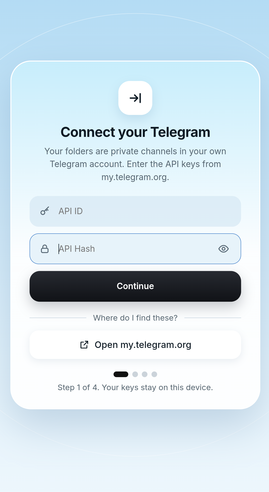
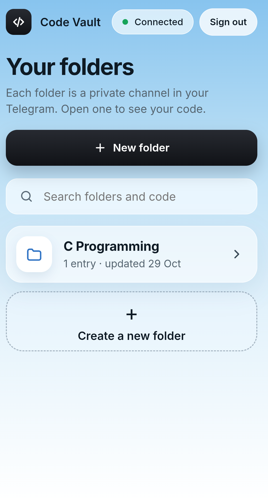
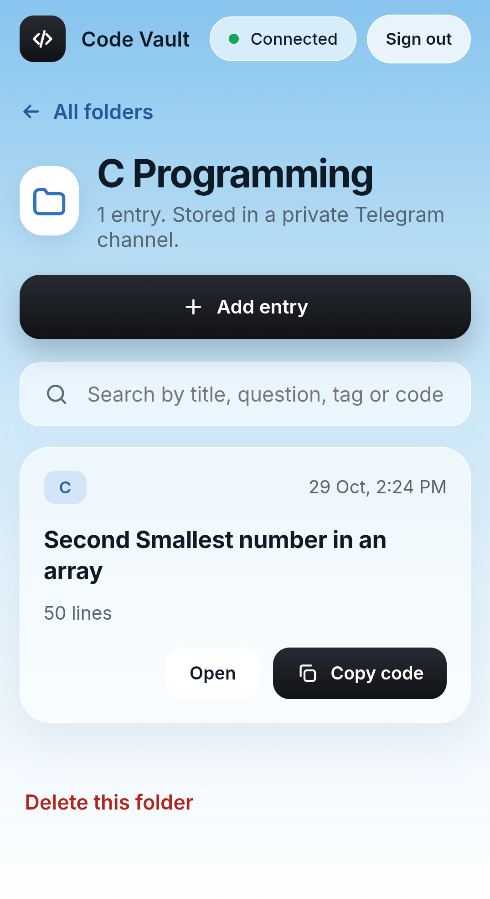
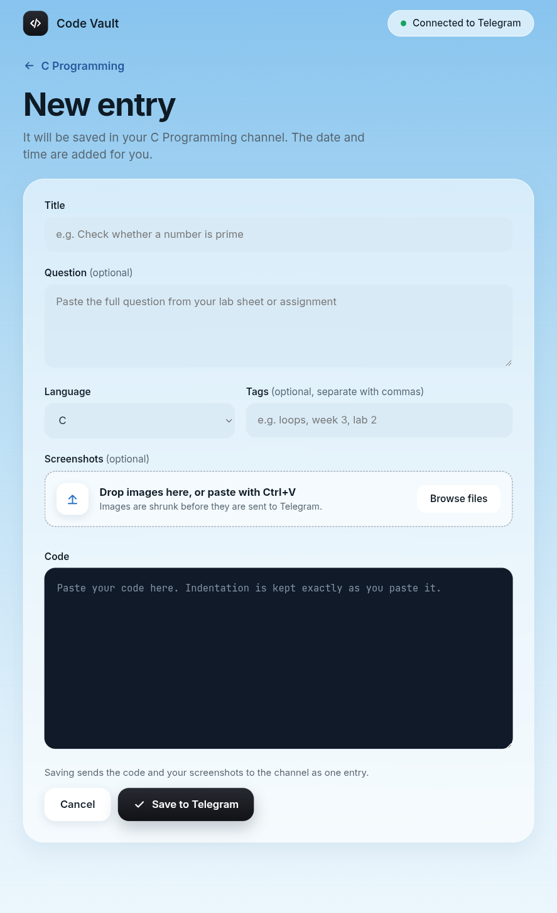
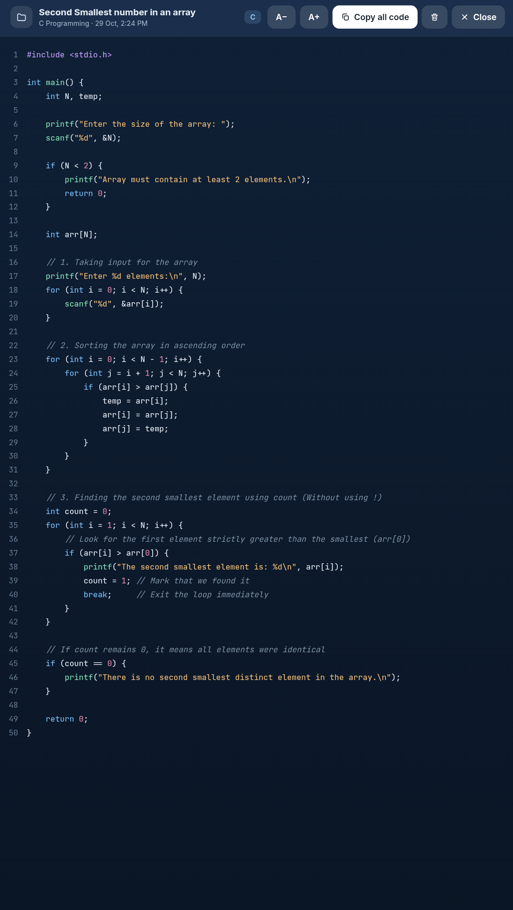
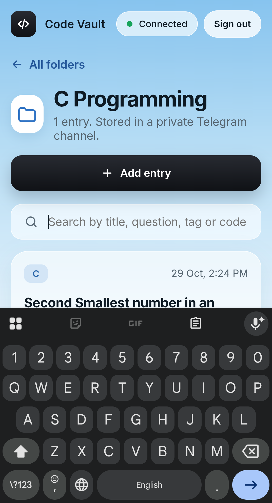

# Telecloud 💻🔐

<p align="center">
  
</p>

<p align="center">
  
  
  
  
  
  
</p>

**Telecloud** is a lightweight web app that turns your own Telegram account into a free, private vault for your coursework code. Create folders and subfolders, save code files with the question and screenshots, and find everything again later from any browser, or from the Android app. Nothing is stored on a third-party server.

🔗 **Live app:** [telecloud-jrn.vercel.app](https://telecloud-jrn.vercel.app)  
📲 **Android app:** [download Telecloud.apk](https://github.com/jony99jrn/telecloud/releases/latest/download/Telecloud.apk) (also on the [Releases](https://github.com/jony99jrn/telecloud/releases) page)

---

## 📌 Table of Contents
- [✨ Key Features](#-key-features)
- [📷 Screenshots](#-screenshots)
- [🧭 How It Works](#-how-it-works)
- [🗑️ The Bin](#️-the-bin)
- [📁 Storage & Data](#-storage--data)
- [🚀 Getting Started & User Guide](#-getting-started--user-guide)
  - [Prerequisites](#prerequisites)
  - [How to Obtain Telegram API Credentials](#how-to-obtain-telegram-api-credentials)
  - [Logging In](#logging-in)
  - [Creating Folders and Entries](#creating-folders-and-entries)
  - [Subfolders, Selecting and Moving](#subfolders-selecting-and-moving)
  - [Searching](#searching)
  - [Install as an App](#install-as-an-app)
  - [Android APK](#android-apk)
  - [How Updates Work](#how-updates-work)
- [🛠️ Developer Guide](#️-developer-guide)
  - [Project Directory Structure](#project-directory-structure)
  - [Run Locally](#run-locally)
  - [Keeping the Repository Clean](#keeping-the-repository-clean)
  - [Deploy to Vercel](#deploy-to-vercel)
  - [Build the Android APK](#build-the-android-apk)
- [⚙️ Troubleshooting](#️-troubleshooting)
- [⚠️ Disclaimer](#️-disclaimer)

---

## ✨ Key Features

*   **☁️ Free Storage in Your Own Telegram**: Every folder is a private Telegram channel in your account. Your code lives in Telegram, so there is no extra server, database or bill.
*   **📂 Folders and Subfolders**: Create one folder for each course, such as "C Programming" or "Data Structures", and split it into subfolders (for example "Lab 1", "Lab 2"). Open a folder to see its entries, newest first.
*   **📝 Rich Entries**: Save the code together with a title, language, tags, the original question text and screenshots. The date and time are added automatically.
*   **🧩 Several Solutions per Entry**: One question can hold more than one solution. Each solution has its own copy button, and each one downloads as its own file.
*   **🔍 Search**: Search folder names, and entry titles, questions and tags across all your folders. Inside an open folder the search also looks through the code itself.
*   **⬇️ Download as Files**: Download one entry, or tick several entries and download them all. Each file is named after the entry title with the right extension, for example `Prime check.c` for a C entry, and the question (if any) is added at the top as a comment.
*   **🎨 Code Viewer**: Full-screen viewer with line numbers and syntax colours for C, C++, Java, Python, JavaScript, SQL and HTML/CSS.
*   **📱 Works on Android and Desktop**: Responsive layout for phones, tablets and computers, with a bottom-sheet style dialog on small screens.
*   **📲 Installable (PWA)**: Add it to your home screen or desktop from the browser menu and open it like a normal app.
*   **🤖 Android APK**: A downloadable APK that opens Telecloud in its own app window. It updates itself whenever the website is updated.
*   **⚡ Offline-Friendly Shell**: A service worker keeps the app screen available when you have no connection. Loading your folders still needs the internet.
*   **🗑️ Bin with Restore**: Deleting a folder or an entry moves it to the Bin first. Restore it any time, or delete it forever from there.
*   **🛡️ Safe Saving**: If the connection to Telegram drops, Telecloud reconnects and retries by itself. An entry is never saved half-way: if a step fails, what was already sent is removed again.
*   **🔒 Private by Design**: Your API keys and login session stay in your own browser, protected by a 6-digit PIN. The app talks directly to Telegram.

---

## 📷 Screenshots

<p align="center">
  
  
  
  
  
  
</p>

<p align="center"><sub>Login · Folders · Entries · New Entry · Code Viewer · Search</sub></p>

---

## 🧭 How It Works

| Concept | What it is in Telegram |
| :--- | :--- |
| **Folder** | A private channel whose title starts with `TC · ` |
| **Subfolder** | A name stored in the caption of each entry (no extra channel is created) |
| **Entry (code)** | A document message holding the code file, with a `#tc` caption that stores the title, language, tags, subfolder and time |
| **Several solutions** | Stored inside the one code file, separated by a marker line |
| **Entry (question)** | An optional text message tagged `#tcq` with the question |
| **Entry (screenshots)** | An optional photo or album tagged `#tci` |

When you open a folder, Telecloud reads the messages inside that channel and rebuilds its entries from them. Each folder's entries are loaded once and kept in memory while the app is open, so going back to a folder you already opened is instant.

> [!NOTE]
> Older versions used `CV · ` folders and the tags `#cv`, `#cvq`, `#cvi` and `#cvpin`. Telecloud still reads all of them, and new data is always saved with the `TC` names.

---

## 🗑️ The Bin

Nothing is deleted right away. When you press **Move to the Bin** on a folder or an entry, it only moves out of sight:

| What you delete | What really happens in Telegram |
| :--- | :--- |
| **Folder** | The channel is renamed from `TC · name` to `TC bin · name`. All its entries stay inside. |
| **Entry** | The tags in its captions change (`#tc` to `#tcbin`, `#tcq` to `#tcqbin`, `#tci` to `#tcibin`). The code, question and screenshots stay in the channel. |

Open the Bin with the **Bin** button on the home page. For each item you can:
*   **Restore**: puts it back exactly as it was (same subfolder, tags, date and screenshots).
*   **Delete forever**: the only action that really deletes from Telegram, and it cannot be undone. For a folder you must type its name to confirm.
*   **Empty Bin**: deletes everything in the Bin forever (you must type `empty`).

> [!NOTE]
> Items in the Bin still count towards your Telegram storage and channel limit until you delete them forever. A folder in the Bin also shows up in the Telegram app as a channel called `TC bin · name`: do not rename it there, or Telecloud will not find it.

---

## 📁 Storage & Data

*   **Your code and screenshots**: Stored as messages in your private `TC · ` channels on Telegram.
*   **Folder size**: When a folder is opened, Telecloud reads up to its newest **20,000 messages**. An entry uses one message for the code, one for the question (if any), and one per screenshot, so a single folder can hold thousands of entries. Very large folders take longer to open.
*   **Subfolders with no entries yet**: An empty subfolder is remembered only in this browser until you put the first entry in it.
*   **API ID and API Hash**: Saved only inside the PIN-encrypted login on this device (never as plain text). They are erased when you sign out, so the next sign-in on that device starts with an empty "Connect your Telegram" page and you paste them once. The Android app keeps its own copy, separate from other browsers.
*   **Login session**: Saved in this browser's `localStorage` only, and **encrypted with your 6-digit PIN** (AES-GCM, key made with PBKDF2), together with the API keys. Each browser or device signs in on its own.
*   **PIN lock**: After your first sign-in you create a 6-digit PIN. Telecloud creates a private channel called **Private PIN for Tele Cloud** in your own Telegram (once) and saves a scrambled hash of the PIN there, never the PIN itself. On a new device you sign in with your login code and then enter the same PIN, so you create it only once. Every time you open the app on a device, it asks for the PIN first and checks it on the device. Do not delete or edit that channel.
*   **Wrong PINs**: After 3 wrong PINs you must wait (30 seconds, doubling each time, up to 1 hour). After 10 wrong PINs the saved login is deleted and you are signed out.
*   **Screenshots**: Shrunk to at most 1600 px and sent as JPEG before upload.
*   **Questions**: Text longer than about 3,900 characters is cut.

> [!WARNING]
> Anyone with access to your browser profile can use your Telegram session. Only sign in on devices you own. A 6-digit PIN is a convenience lock, not strong protection against someone who has copied your browser data, so choose a PIN that is hard to guess and keep your device locked.

---

## 🚀 Getting Started & User Guide

### Prerequisites
*   An active Telegram account.
*   A modern browser on Android or Windows (Chrome, Edge or Firefox), or the Android APK.
*   An internet connection.

### How to Obtain Telegram API Credentials
Telecloud needs your own API credentials to connect to Telegram. This is free and takes about 2 minutes:
1. Go to [my.telegram.org](https://my.telegram.org/) and log in with your phone number.
2. Select **API development tools**.
3. Fill in the form (an app title and short name of your choice).
4. Copy the **App api_id** and **App api_hash**.
5. Paste them into the first screen of Telecloud.

> [!NOTE]
> These credentials stay in your browser. The app does not send them to any server other than Telegram.

### Logging In
1. Open the site and enter your **API ID** and **API Hash**.
2. Enter your phone number in international format (for example `+8801XXXXXXXXX`).
3. Enter the login code that Telegram sends to your account.
4. If you use two-step verification, enter your password.
5. Create your 6-digit PIN (first sign-in only), or enter it on a new device.

### Creating Folders and Entries
1. Press **New folder**, type a name, and confirm. A private channel named `TC · <name>` is created in your Telegram.
2. Open the folder and press **Add entry**: write a title, choose the language, add tags, paste your code, and optionally add the question, more solutions and screenshots. You can also pick a subfolder.
3. Press **Save to Telegram**. The entry appears in the folder with the date and time.

### Subfolders, Selecting and Moving
*   Press **New subfolder** inside a folder to make one, then choose it when you add or edit an entry.
*   Press **Select** to tick several entries. You can then **Download** them together or **Move** them into a subfolder (or out of one). Moving only changes the entry's caption, so the code, question and screenshots are not touched.

### Searching
*   **On the home page**: finds folders by name, and entries by title, question or tag, across all your folders. The first search may take a moment because each folder's entries are loaded once.
*   **Inside a folder**: also searches the code itself.

### Install as an App
Open the browser menu and choose **Install app** or **Add to Home screen**. Telecloud then opens in its own window.

### Android APK
1. Download `Telecloud.apk` onto your phone, either with the **Get app** button on the website (it only shows in a normal browser, never inside the app itself) or from the [Releases](https://github.com/jony99jrn/telecloud/releases) page.
2. Tap the file. If Android blocks it, allow **Install unknown apps** for the app you opened it from, then tap Install.
3. Open **Telecloud** and sign in with your API ID, API Hash, phone number and login code. Your folders and entries appear, because they are stored in your Telegram.

> [!NOTE]
> The first time you open the app, Android may show "Running in Chrome" with a note about site data. This is normal: the app runs the website through Chrome, so its sign-in data is kept in Chrome's storage for this site.

### How Updates Work
The APK does not contain the code. It opens the live website, so:
1. You push changes to GitHub.
2. Vercel redeploys the website.
3. The app shows the new version the next time you open it with internet.

A new APK is only needed if you change the app name, icon or package settings.

---

## 🛠️ Developer Guide

### Project Directory Structure
```
telecloud/
├── public/
│   ├── .well-known/
│   │   └── assetlinks.json      # Links the APK to the site (hides the browser bar)
│   ├── icon.svg                 # App icon (browser tab)
│   ├── icon-192.png             # PNG icons for installing on Android
│   ├── icon-512.png
│   ├── icon-maskable-512.png
│   ├── apple-touch-icon.png
│   ├── manifest.webmanifest     # PWA manifest
│   └── sw.js                    # Service worker (offline app shell)
├── src/
│   ├── main.js                  # Interface: screens, routing, dialogs
│   ├── telegram.js              # Telegram layer: login, folders, entries
│   ├── lock.js                  # PIN lock: encryption and the wrong-PIN limit
│   ├── solutions.js             # Several solutions inside one entry
│   ├── highlight.js             # Syntax colours for the code viewer
│   └── styles.css               # Layout and look (mobile and desktop)
├── screenshots/                 # README images
├── .gitignore                   # Files Git must never upload
├── index.html
├── package.json
├── package-lock.json            # Exact package versions (commit this file)
└── vite.config.js               # Vite + Node polyfills for GramJS
```

### Run Locally
```bash
git clone https://github.com/jony99jrn/telecloud.git
cd telecloud
npm install
npm run dev
```

To create a production build:
```bash
npm run build
npm run preview
```

> [!TIP]
> On Termux (Android), `npm install` can fail while building optional native packages because Python and build tools are missing. If you only need to create or update the lockfile, run `npm install --package-lock-only` instead.

### Keeping the Repository Clean
*   **`.gitignore`** keeps `node_modules/`, `dist/`, `.env` files, logs and signing keys (`*.keystore`, `*.jks`) out of Git, so `git add .` is safe to use.
*   **`package-lock.json`** is committed on purpose. It makes every install, including Vercel's, use the same package versions, so a new release of a dependency cannot break a deploy by surprise. Update it only when you add or upgrade a package.
*   **Never commit the Android signing key.** See the warning in the APK section below.

### Deploy to Vercel
1. Push the project to a GitHub repository.
2. On [vercel.com](https://vercel.com/), choose **Add New, Project** and import the repository.
3. Vercel detects Vite automatically. Use the build command `npm run build` and the output folder `dist`, then press **Deploy**.

### Build the Android APK
The APK is made from the live website with [PWABuilder](https://www.pwabuilder.com/), which needs no Android tools:
1. Deploy the site to Vercel and check that `/manifest.webmanifest` opens with the PNG icons listed.
2. On PWABuilder, enter your site address and press **Start**.
3. Press **Package for stores**, choose **Android**, and press **Generate package**.
4. In the popup, set the **Package ID** (for example `com.jony99jrn.codevault`) and the app name, then press **Generate** and **Download**.
5. Unzip the download. Install the `.apk` on your phone.
6. Copy the `assetlinks.json` from the zip into `public/.well-known/assetlinks.json` in this repo, then push. This hides the browser bar at the top of the app.
7. Rename the `.apk` to exactly `Telecloud.apk` and attach it to the release (see below).

#### Publish the APK with every release
The website's **Get app** button points to `https://github.com/jony99jrn/telecloud/releases/latest/download/Telecloud.apk`, which is the file in the **newest** release.
1. On GitHub, open **Releases** and press **Draft a new release**.
2. Choose a tag such as `v1.0.1` and add release notes.
3. Attach the file named exactly `Telecloud.apk`.
4. Press **Publish release**.

> [!WARNING]
> Attach `Telecloud.apk` to **every** release. If the newest release has no file with that exact name, the download button shows a "Not Found" page. Releases marked as pre-release or draft are ignored by the button.

> [!IMPORTANT]
> Keep the signing key (the `.keystore` file and its password) from the zip in a safe place, and **never commit it to GitHub**. The `.gitignore` file blocks `*.keystore` as a safety net. Android only accepts an update over the installed app if it is signed with the same key, so if you lose the key you cannot update the existing app.

---

## ⚙️ Troubleshooting

*   **Folder was not created**: Telegram limits how fast channels can be created. If the message asks you to wait, wait that long and try again. Also check that your account does not already have too many channels.
*   **Login code does not arrive**: Telegram limits how often it sends codes. Wait a few minutes and try again, and check that the API ID and API Hash match the ones on `my.telegram.org`.
*   **Folders or entries are missing**: First check the **Bin**, because deleted items wait there and can be restored. Also do not rename or delete the `TC · ` or `TC bin · ` channels, or the messages inside them, in Telegram itself, or Telecloud will not find them.
*   **A very large folder opens slowly or looks incomplete**: Telecloud reads up to the newest 20,000 messages of a folder. Entries older than that are still in Telegram but do not show in the app. Splitting the folder into two is the simplest fix.
*   **Search does not find text inside my code**: On the home page, search covers titles, questions and tags. Open the folder and search there to search the code too.
*   **"New login" notice from Telegram**: This is expected. It is Telecloud signing in to your account.
*   **Sign out**: Ends the Telegram session for this app and removes the saved login from this device. Next time you sign in with a login code and enter your PIN (it is not created again).
*   **Forgot PIN**: Tap "Forgot PIN?" on the PIN screen. Telegram sends you a login code, and after you enter it you create a new PIN. The new PIN replaces the old one on all your devices. Your folders and code stay safe in Telegram.
*   **Old version after an update**: Close and reopen the tab or the app (sometimes twice), or clear the site data in your browser, so the new files load.
*   **"Running in Chrome" notice in the APK**: This is normal and appears once. The app runs the website through Chrome.
*   **Browser bar shows at the top of the APK**: Open `/.well-known/assetlinks.json` on your site. If it is missing or does not come from the same download as your APK, fix the file, redeploy, then reinstall the APK.
*   **Signed out in the APK**: Clearing Chrome's site data for the site also signs the app out. Your files are safe in Telegram, so just sign in again.

---

## ⚠️ Disclaimer

This project is an independent open-source project made for learning purposes. It is not affiliated with, endorsed by, or officially connected to Telegram Messenger or any other company.

You are responsible for using this app in line with Telegram's Terms of Service and the laws that apply to you. The author is not liable for any account action, data loss or misuse resulting from the use of this software.

---

<p align="center">Made by <a href="https://github.com/jony99jrn">jony99jrn</a></p>
